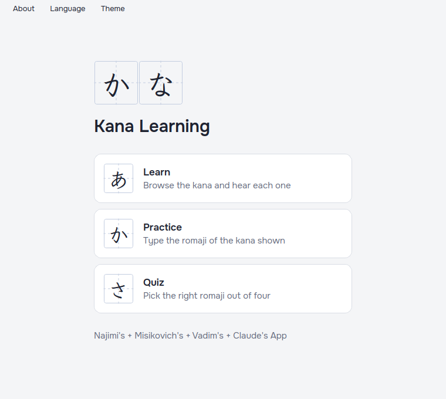
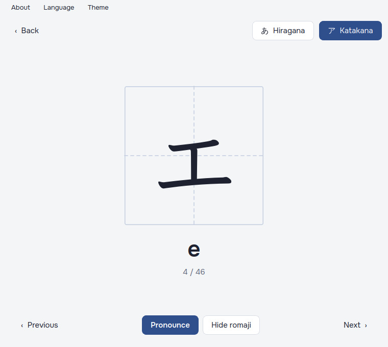
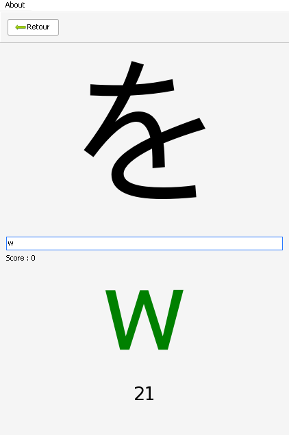

kana-app
========

Kanapp is a small desktop app for learning the Japanese kana (hiragana and katakana). You can browse the kana and hear how each one is pronounced, or test yourself with a timed quiz.

This is a **fork** of [kana-app/kana-app](https://github.com/kana-app/kana-app), the C++/Qt app Adonis Najimi wrote as a summer project to learn C++. This fork keeps the app as it was and makes it build and run again on current systems:

- **Ported from Qt 5 to Qt 6**, with a CMake build alongside the original `kanapp.pro`.
- **Windows build:** a portable Windows x86_64 build, cross-compiled from Linux. Download the zip from the [Releases](https://github.com/misikovich/kana-app/releases) page, unzip it anywhere and run `kanapp.exe`.
- **Quiz fixes:**
  - The best score was erased by any game that didn't beat it.
  - The streak bonus doubled the whole score, and typing the first letter of an answer broke the streak.
  - Scores weren't reset between games, and mistakes were counted several times after the first game.
  - Leaving a game with "Retour" didn't stop its timer.
  - The same kana could come up several times in a row.
- **Other fixes:** the About menu now works, the build compiles on Linux (file-name case), and the Windows icon file was repaired.
- The best score is now saved per user (in `%APPDATA%\Najimi\Kana Learning\` on Windows) rather than next to the executable.

## Screenshots

| Main menu | Learn | Quiz |
|:---:|:---:|:---:|
|  |  |  |

## How to use

**Learn:** step through the kana with *Previous* / *Next* or the Left / Right arrow keys. Switch between Hiragana and Katakana in the toolbar or with Up / Down. *Pronounce* plays the sound, and *Hide romaji* (or Space) hides the romaji so you can test yourself.

**Quiz:** press *Start* and pick how many seconds you get per kana (10, 20 or 30). Type the romaji for the kana shown. Your input turns green while it's on track and red when it isn't. Answering quickly and getting several right in a row earns more points. The game ends after more than 5 missed kana, and your best score is saved.

The interface is available in English, French and Russian: pick one from the *Language* menu. On first launch the app follows the system language.

## Building

You need Qt 6 (Widgets, Multimedia and the Linguist tools), CMake and Ninja.

```sh
# Linux (Debian/Ubuntu: qt6-base-dev qt6-multimedia-dev qt6-l10n-tools qt6-tools-dev cmake ninja-build)
cmake -S . -B build-linux -G Ninja
cmake --build build-linux
./build-linux/kanapp
```

```sh
# Windows x86_64, cross-compiled from Linux -> dist/kanapp-windows.zip
./build-windows.sh
```

The Windows build needs the mingw-w64 compiler and Qt's official Windows MinGW binaries (`qtbase` and `qtmultimedia`) extracted into `~/qt-win`. Their version must exactly match the host Qt. See [CLAUDE.md](CLAUDE.md) for the details.

## Credits

The original app is by **Adonis Najimi** ([kana-app/kana-app](https://github.com/kana-app/kana-app)). The author asked: *"Don't forget to talk about the author if you want to use my works!"*

The fork is maintained by misikovich and Vadim, with help from Claude.
